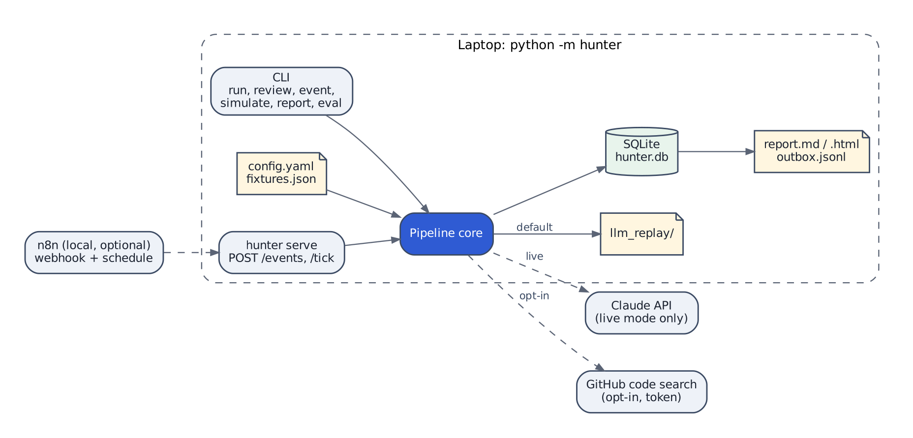

# Scylla Hunter

A small, runnable PoC for an AI-driven competitor-displacement hunter: it finds people at companies that show evidence of running DataStax or Apache Cassandra, qualifies them with a deterministic score, drafts a LinkedIn invite and follow-up email with an LLM, runs the trigger/approval logic in dry-run, and reports what happened. No real sending, no LinkedIn scraping, no API key required to run it.

Full spec: **[PRD.md](PRD.md)**. Build log: **[AI_WORKFLOW.md](AI_WORKFLOW.md)**.

## Quickstart (no keys, ~2 minutes, Python 3.11+)

```bash
git clone https://github.com/OzShwartz/Scylla-Hunter-POC.git && cd Scylla-Hunter-POC
python3 -m venv .venv && source .venv/bin/activate
pip install -r requirements.txt
python -m hunter reset
python -m hunter run                 # 5 qualified leads; 2 invites auto-sent, 3 pending
python -m hunter review              # see pending drafts with evidence and routing reason
python -m hunter approve --all       # approves the score-band ones; skips anything content-sensitive
python -m hunter simulate --days 7   # 2 accept -> warm email; 3 don't -> cold email
python -m hunter review              # msg#6, #9, #10 are tagged [SENSITIVE CONTENT]
python -m hunter approve --all       # skips #6/#9/#10 again, with their ids
python -m hunter approve 6 && python -m hunter approve 9 && python -m hunter approve 10
python -m hunter report --html       # examples/report.md and examples/report.html
```

These message ids are deterministic - replay mode makes the same drafts every time, in the same order. Everything above runs against a committed **replay set** (`data/llm_replay/`): real Claude responses recorded once, replayed deterministically. `--llm live` plus `ANTHROPIC_API_KEY` in `.env` re-records them; the reviewer never needs a key.

## The problem, and how I read it

ScyllaDB is CQL/Cassandra-compatible, so a team running DataStax or Cassandra can switch with the lowest rewrite cost of any competitor's customer base. IBM completed its acquisition of DataStax in May 2025 - a classic moment for a buyer to re-evaluate options, which the project treats as a *neutral* trigger, never fear-based messaging (enforced in code, not just asked for in the prompt - see §9.6 and `validators.is_sensitive_content`).

"Users of DataStax" is read as *people at companies with evidence of running DataStax products or self-managed Apache Cassandra* - not DataStax employees (suppressed), and self-managed Cassandra counts because the same compatibility argument applies. Discovery is **account-first**: evidence qualifies a company, then the right people are chosen inside it, ending in a LinkedIn profile URL per lead - never a raw LinkedIn search or scrape. Full reasoning, assumptions, and the questions this would need answered from a real hiring manager: **[PRD.md §3](PRD.md#3-discovery-business-context-and-why-now), [§21](PRD.md#21-assumptions-and-open-questions)**.

## Architecture



**Code decides what happens. The LLM decides only how it's worded. n8n (production) decides when.** Qualification, scoring, routing and triggers are deterministic Python - testable, explainable, free to re-run. The LLM is called in exactly two places (`hunter/extract.py`, `hunter/personalize.py`), both through `hunter/llm.py`. More diagrams (DFD, ERD, lifecycles) in `docs/diagrams/` and PRD §14.

## Data

Every company and person is **fictional** - `.example` domains, invented names - built to model real source *types* (customer-reference pages, job posts, conference talks, technographics, reviews, GitHub code search). `data/fixtures.json` also encodes deliberate edge cases the pipeline has to get right, each exercised by a test:

- a person named **Cassandra** (Pinecrest Analytics) - a keyword false positive, not a technology
- a **stale** 2021 case study (Orbit Media) - recency decay should sink it
- a **champion move**: someone quoted at one account joins another (Brightwave AI)
- a **competitor employee** (DataStax) and an **existing ScyllaDB customer** (Quanta Retail) - both suppressed
- an **opted-out** contact (Lumen Logistics) - suppressed permanently
- a **too-small** company (Sprocket Labs, 12 employees) - rejected by the ICP gate

## One lead, end to end: Maya Rosen

Real output from `examples/run_log.txt` - nothing in this section is invented.

1. **Evidence.** `s01`, a customer-reference page, high confidence: *"Northwind Payments runs fraud scoring on Astra DB."*
2. **Score breakdown.** `evidence=55.7, icp=25, why_now=15` → **account score 96** (≥ 80 auto-approve threshold).
3. **Invite** (auto-approved, sent): *"Hi Maya, I'm Oz, GTM Engineer at ScyllaDB. I saw that Northwind Payments runs fraud scoring across multiple regions at 40k transactions per second, with tight read-latency requirements. I'd be glad to connect."*
4. **Accepted event** (`hunter simulate --days 7`, scripted day 2): lead status `INVITED` → `ACCEPTED`.
5. **Warm email drafted** - the full text, unedited:

   > Hi Maya, thanks for connecting.
   >
   > I saw that Northwind Payments runs fraud scoring on Astra DB, with single-digit millisecond reads across three regions at 40k transactions per second. That is a demanding profile to keep cost-efficient as volume grows.
   >
   > ScyllaDB is built for that kind of workload. Higher throughput per node typically means fewer nodes and lower infrastructure cost. With DataStax now part of IBM, this may also be a reasonable moment to review options.
   >
   > Would you be open to comparing notes on how your fraud-scoring cluster is sized today?
   >
   > Oz
   > GTM Engineer, ScyllaDB
   >
   > Reply STOP to opt out.

6. **Route: forced to human review.** Score alone (96) would auto-approve. The draft's content - the competitor product name and the acquisition clause above - overrides that unconditionally (`hitl.determine_route`, code `sensitive_content`). This is the project's central finding: **account score measures lead quality, not message risk**, and the two are independent. `hunter review` tags it `[SENSITIVE CONTENT]`; `approve --all` skips it; a human reads it and approves (or doesn't) individually.

## How quality is measured

`hunter eval` scores every run against fixture `_expected` values - never read by the pipeline itself, only by the evaluator: **32/32** extraction fields, **13/13** lead selections, **10/10** grounded messages. **152 automated tests** cover scoring, gates, validators, HITL routing, triggers, dispatch, the report, and the GitHub source. Grounding is enforced in code, not just prompted: every `evidence_quote` must be a verbatim substring of the source text, every cited evidence id must exist and belong to the lead's account, and every named person must actually appear in the source.

## Key decisions

| Decision | Why |
|---|---|
| Account-first discovery, ending in a LinkedIn profile URL | Answers "identify users on LinkedIn" without scraping or automating LinkedIn, which breaches its ToS - LinkedIn sued data provider Proxycurl in Jan 2025, which shut down that July |
| Deterministic scoring, selection, routing and triggers | Explainable and testable; an SDR or GTM lead can audit *why*, not just *what* |
| Grounding enforced in code, not just prompted | A model will still occasionally mislabel a quote or restate a fact loosely - verbatim-substring checks and evidence-existence checks catch what a prompt instruction alone doesn't |
| Content-sensitive HITL override | Found empirically (Phase 2): the highest-scoring account produced the most commercially sensitive draft and, on score alone, would have auto-sent - score and risk are orthogonal, so routing now checks both |
| Replay mode as the default | The reviewer runs the whole thing in minutes, with no key, deterministically - see `hunter/llm.py` |
| No LinkedIn scraping or automation, anywhere | Legal/ToS risk is real and recent; invites are "sent" only to console + `outbox.jsonl` |

## Requirements → where

| The assignment asked for | Where it's met |
|---|---|
| Identify relevant users on LinkedIn | Account-first discovery → people lookup, ending in a LinkedIn profile URL per lead (`hunter/scoring.py`, `hunter/sources.py`) |
| AI-personalized invite + follow-up email | `hunter/personalize.py`, via Claude (`hunter/llm.py`), grounded and validated |
| Trigger logic, with a dry run | R1-R3 in `hunter/triggers.py`: qualified → invite; accepted → warm email; no reply in 7 days → cold email. Dry-run to console + `outbox.jsonl` (`hunter/dispatch.py`) |
| A report of leads gathered/selected/sent, kept in a database | SQLite, 6 tables (`hunter/db.py`); `hunter report --html` (`hunter/report.py`) |

## What I deliberately left out, and why

- **Real sending, any channel.** `dry_run: true` always; FR-9's acceptance criterion is literally "no network call to any channel exists in the code path" (verified by grep, not just by convention).
- **LinkedIn automation or scraping.** Out of scope on legal grounds, not a time constraint.
- **Live Apollo/people-API calls.** The exact request is generated and logged (`people_query` in the account record); nothing is actually sent.
- **CRM sync, a UI beyond the report, reply classification, A/B testing.** All production-roadmap items (§20) that need real outcome data this PoC has no way to generate.

## Path to production

| Concern | PoC | Production |
|---|---|---|
| Triggers and time | CLI + simulated clock | n8n schedules and webhooks |
| System of record | SQLite | Salesforce; Postgres for evidence/audit |
| Sending | Dry-run to console + outbox | Human-approved; LinkedIn always manual |
| Sources | Fixtures + GitHub (opt-in) | Real sources behind the same input shape |
| Decision logic | Python core | Same Python core, unchanged |

Full version: **[PRD.md §14.5](PRD.md#145-infrastructure)**, **[§20](PRD.md#20-out-of-scope-and-production-roadmap)**.

## GitHub live source (FR-2)

`python -m hunter run --source github` runs the configured code-search queries (`com.datastax.oss`, `cassandra-driver`, `astrapy`) against the real GitHub API (`GITHUB_TOKEN` in `.env`) and classifies every organization-owned match before any of it becomes an account - a raw code match is noise, not a lead, until it's filtered. Real output from a live run:

```
GitHub source (live): 10 raw match(es) -> 2 probable user(s), 8 excluded (gh_sky-uk, gh_quintoandar)
```

**10 raw matches → 2 probable users.** Every exclusion was individually verified against the actual matched file, not assumed - that's the point of this funnel:

| Org | Matched path | Verdict | Reason |
|---|---|---|---|
| sky-uk | `src/.../cqlmigrate/CqlLoader.java` | **probable user** | their own Cassandra schema-migration tool |
| quintoandar | `requirements.txt` | **probable user** | their own feature-store tool, root-level dependency |
| stargate | `coordinator/testing/.../UdfTest.java` | excluded - competitor | DataStax-sponsored project (DataStax CLA governs contributions) |
| thelastpickle | `src/server/.../AppContext.java` | excluded - competitor | acquired by DataStax, March 2020 |
| deepset-ai | `integrations/astra/examples/requirements.txt` | excluded - integration | path is literally under `integrations/.../examples/` |
| rocketride-org | `nodes/.../store_astra/requirements.txt` | excluded - integration | `store_astra` is 1 of 8+ pluggable storage-backend nodes (also `store_pinecone`, `store_qdrant`, ...) |
| AI-Northstar-Tech | `requirements.txt` | excluded - integration | a universal multi-vector-DB interface; Astra DB is 1 of 9 supported backends |
| alibaba | `docs-requirements.txt` | excluded - integration | an OpenTelemetry-style instrumentation library; Cassandra is 1 of dozens of per-library modules |
| Dataherald | `services/engine/requirements.txt` | excluded - integration | that file lists `astrapy` alongside 12+ other DB connectors (Postgres, MySQL, Snowflake, ...) |
| neurodata | `setup/requirements.txt.old` | excluded - stale path | a `.old` file - not a currently-used dependency |

A `probable_user` account gets no firmographics (`employees: null`) → status `NEEDS_ENRICHMENT`, plus a generated people-search query - it's still not scored or contacted; a human enriches and confirms before anything moves forward. Without a token, the command falls back to the committed, dated snapshot (`data/github_snapshot.json` - org/repo-level facts only, no individual contributor data) and says so; the same classification pipeline runs over it either way. See `tests/test_sources.py`, including a test that pins this exact verified table.

## n8n trigger layer (FR-12, optional)

`python -m hunter serve` exposes `POST /events` and `POST /tick` - the exact same trigger logic the CLI's `event`/`simulate` commands call, just reachable over HTTP. `n8n/hunter_triggers.json` wires a webhook (connection accepted → `/events`) and a daily schedule (→ `/tick`); `n8n/README.md` has the exact steps to run it locally with `npx n8n`. Optional - the CLI demo above is the primary path; this just shows how the same core maps onto the stack named in the job description.

## How this was built

Built with [Claude Code](https://claude.com/claude-code) in VS Code. `CLAUDE.md` holds the project's non-negotiable rules (dry-run by default, grounding in code, secrets handling, replay-first). `.claude/skills/` holds three repeatable workflows: `run-eval`, `record-replay`, `pre-submit`. The full build log - every significant prompt, every mistake caught and how, every human decision - is in **[AI_WORKFLOW.md](AI_WORKFLOW.md)**, including a "Highlights" table of the specific cases where human review caught something the automated checks missed.
